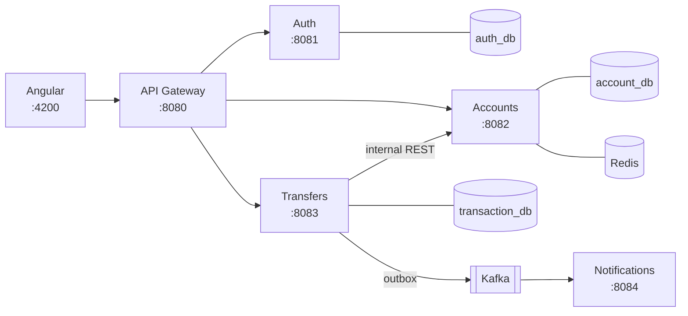

# Banking Microservices

A digital banking app I built to get hands-on with the patterns that come up in real backend systems: distributed transactions, event-driven messaging, and API gateway security. You can register, open accounts, and send money between them through an Angular dashboard, while five Spring Boot services coordinate behind the scenes.

**Stack:** Java 21, Spring Boot 3, Spring Cloud Gateway, Kafka, PostgreSQL, Redis, Angular 18, Docker

## How it works



Each service has its own Postgres database and they only talk to each other over REST or Kafka. Everything from the outside comes in through the gateway, which checks the JWT once and passes the user's identity downstream in headers the client can't fake. In the Docker setup the backend services aren't even reachable from the host — only the gateway is.

The interesting part is the transfer flow. Moving money touches two accounts in a different service than the one recording the transaction, so there's no single database transaction to lean on. Instead the transaction service runs a small saga: save a PENDING record, debit the source, credit the destination, and if the credit fails, refund the source. If even the refund fails, the transfer is marked `COMPENSATION_REQUIRED` and an alert event goes out — money is never silently lost. Each state change commits on its own, so a crash mid-transfer always leaves an honest record behind.

Events (transfer completed/failed) are written to an outbox table in the same transaction as the state change, and a background job ships them to Kafka afterwards. That way an event can't get lost even if Kafka is down at the moment the transfer commits. The notification service consumes them and "sends" emails (logged, not actually sent — I didn't want to wire up SendGrid for a demo).

A few other things I made sure of:

- Retrying a transfer never charges twice — clients send an `Idempotency-Key`, and replays get the original result back
- Two transfers hitting the same account at the same time can't read a stale balance (pessimistic row locks)
- You can only see and move money in *your own* accounts; the services check ownership on every call
- Five wrong passwords lock the account; transfers are rate-limited per user through Redis

## Running it

You'll need JDK 21, Maven, Node 18+, and Docker.

```bash
git clone https://github.com/kelsonbrito50/banking-microservices.git
cd banking-microservices

# secrets: copy the template and fill in JWT_SECRET and POSTGRES_PASSWORD
# (the file explains how to generate random values; .env is git-ignored)
cp .env.example .env

# infrastructure: 3x Postgres, Redis, Kafka
docker compose up -d postgres-auth postgres-account postgres-transaction redis kafka

# each service in its own terminal, with the .env values exported
# (on Windows, start-all.ps1 loads .env and opens all five)
set -a; . ./.env; set +a; export DB_PASSWORD="$POSTGRES_PASSWORD"
mvn -f auth-service/pom.xml spring-boot:run
mvn -f account-service/pom.xml spring-boot:run
mvn -f transaction-service/pom.xml spring-boot:run
mvn -f notification-service/pom.xml spring-boot:run
mvn -f api-gateway/pom.xml spring-boot:run

# frontend
cd frontend && npm install && npm start
```

Then open http://localhost:4200, create an account, and try a transfer. Or run the whole thing in containers with `docker compose up -d --build`.

If you prefer the terminal:

```bash
TOKEN=$(curl -s -X POST localhost:8080/api/auth/login -H 'Content-Type: application/json' \
  -d '{"email":"me@test.com","password":"password123"}' | jq -r .accessToken)

# demo opening balance: 0 to 1000 (there is no deposit flow)
curl -X POST localhost:8080/api/accounts -H "Authorization: Bearer $TOKEN" \
  -H 'Content-Type: application/json' -d '{"initialDeposit":1000}'

curl -X POST localhost:8080/api/transfers -H "Authorization: Bearer $TOKEN" \
  -H "Idempotency-Key: $(uuidgen)" -H 'Content-Type: application/json' \
  -d '{"fromAccount":"AAA","toAccount":"BBB","amount":250}'
```

## API

Everything goes through `localhost:8080`; routes marked 🔒 need `Authorization: Bearer <token>`.

| Method | Endpoint | Description |
|---|---|---|
| POST | `/api/auth/register` | Register with email + password (8+ chars) |
| POST | `/api/auth/login` | Get a JWT (15 min) |
| POST 🔒 | `/api/accounts` | Open an account |
| GET 🔒 | `/api/accounts` | List your accounts |
| POST 🔒 | `/api/transfers` | Transfer money (needs `Idempotency-Key` header) |
| GET 🔒 | `/api/transfers/history/{accountNumber}` | Last 50 transfers on your account |

## Layout

```
api-gateway/            JWT verification, rate limiting, CORS, routing
auth-service/           register/login, BCrypt, lockout, JWT issuing
account-service/        accounts, balances, debit/credit with row locks
transaction-service/    the saga, idempotency, transactional outbox
notification-service/   Kafka consumers (mock emails)
frontend/               Angular dashboard
```

## What I'd add next

- Refresh tokens and revocation (right now it's a single short-lived access token)
- Integration tests with Testcontainers — the transfer flow really deserves them
- A WebSocket feed so the dashboard updates without refreshing
- CI with GitHub Actions
- Tracing across services (Micrometer + Zipkin) — debugging a saga from five separate log files gets old fast
